Full stack developer with hands-on internship experience building landing pages, e-commerce websites and an expense tracker with HTML, CSS, JavaScript, Bootstrap, Tailwind CSS and React. 
Currently learning backend development with Python and Django, and open to job opportunities.

- Full stack developer, with a BS in Information Technology from the University of Sahiwal
- Learning backend development with **Python** and **Django**
- Looking for job opportunities
- I speak Urdu, English and Punjabi

| Role | Company | What I did | Tools |
|------|---------|------------|-------|
| Intern | IT Virtual House | Built landing pages, an expense tracker and e-commerce websites | HTML, CSS, JavaScript, Bootstrap, Tailwind CSS, React |

| Project | What it does |
|---------|--------------|
| **Expense tracker** | Tracks personal expenses |
| **BioLab app** | Collects data and samples about students and generates analysis from that data |
| **E-commerce website** | An online store website |

**Backend** (learning) 

**Frontend** 

**Databases** 

| Area | What I use or have built |
|------|--------------------------|
| Frontend development | HTML, CSS, JavaScript, React |
| UI styling | Bootstrap, Tailwind CSS |
| Landing pages and e-commerce sites | Built during my internship at IT Virtual House |
| Backend development | Python and Django (learning) |
| Databases | MySQL |
| Data collection and analysis | BioLab app |

**BS Information Technology**, University of Sahiwal

I'm open to job opportunities. The best way to reach me is by email.

Thanks for stopping by.

